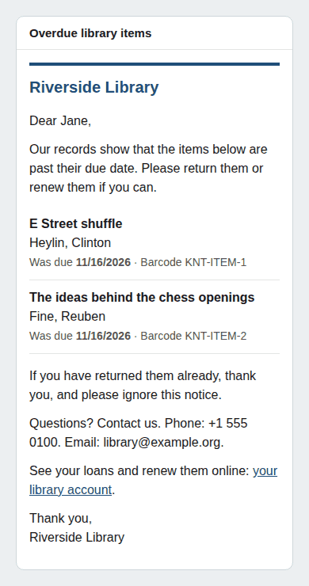
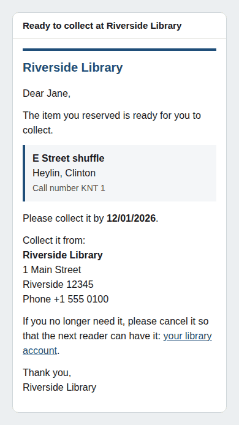
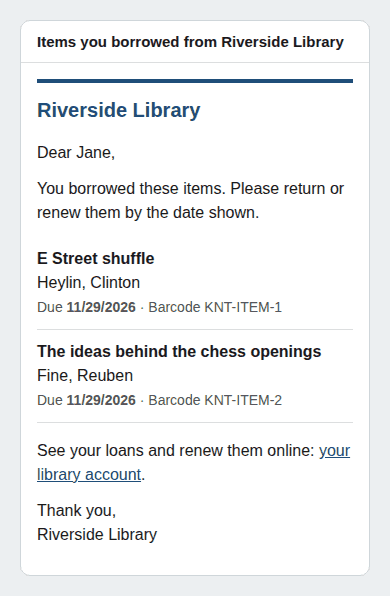

# koha-notice-templates

Clean, mobile-friendly notices for Koha: ready-to-paste templates for *Tools → Notices and slips*, each run through
a real Koha checkout, check-in or slip print before it is published.

[](https://github.com/kohasolutions/koha-notice-templates/actions/workflows/ci.yml)
[](LICENSE)
[](TESTED.md)

18 notices, each in every format Koha sends it in, **159 of 159 checks passed on Koha 26.05.02** ([TESTED.md](TESTED.md);
the full run log is attached to each [release](https://github.com/kohasolutions/koha-notice-templates/releases)).

<p>
  
  
  
</p>

Every notice folder has pictures of what Koha really sent: `preview-phone.png`, `preview-desktop.png`,
`preview-sms.png` and, where there is one, `preview-print.png`.

Want your own colours and layout without editing code? The
[notice template builder](https://github.com/kohasolutions/koha-notice-template-builder) makes these templates in the
browser, with eight designs and a live preview.

| Code | Koha menu | What it is | Email (HTML) | Email (text) | SMS | Print |
|---|---|---|---|---|---|---|
| `CHECKOUT` | Circulation | receipt for the items borrowed in one visit | ✓ | ✓ | ✓ | |
| `CHECKIN` | Circulation | receipt for the items returned in one visit | ✓ | ✓ | ✓ | |
| `PREDUE` | Circulation | item due soon (one message per item) | ✓ | ✓ | ✓ | |
| `DUE` | Circulation | item due today (one message per item) | ✓ | ✓ | ✓ | |
| `PREDUEDGST` | Circulation | items due soon, all in one message (*Digests only*) | ✓ | ✓ | ✓ | |
| `DUEDGST` | Circulation | items due today, all in one message (*Digests only*) | ✓ | ✓ | ✓ | |
| `ODUE` | Circulation | first overdue notice, every item of the stage in one message | ✓ | ✓ | ✓ | ✓ |
| `ODUE2` | Circulation | second overdue notice, firmer | ✓ | ✓ | ✓ | ✓ |
| `ODUE3` | Circulation | final overdue notice, firmest | ✓ | ✓ | ✓ | ✓ |
| `HOLD` | Holds | hold ready for pickup, with the deadline and the pickup library | ✓ | ✓ | ✓ | ✓ |
| `HOLDDGST` | Holds | holds ready for pickup, added to one message (*Digests only*) | ✓ | ✓ | ✓ | |
| `HOLD_REMINDER` | Holds | holds still waiting, one message per patron and library | ✓ | ✓ | ✓ | ✓ |
| `AUTO_RENEWALS` | Circulation | automatic renewal result: renewed, or not renewed and why | ✓ | ✓ | ✓ | |
| `AUTO_RENEWALS_DGST` | Circulation | automatic renewal results, all in one message (*Digests only*) | ✓ | ✓ | ✓ | |
| `WELCOME` | Patrons (members) | new member: card number, user name, how to reach the account | ✓ | ✓ | | ✓ |
| `MEMBERSHIP_EXPIRY` | Patrons (members) | membership ending soon | ✓ | ✓ | ✓ | ✓ |
| `PASSWORD_RESET` | Patrons (members) | link to set a new password (asked for in the OPAC) | ✓ | ✓ | | |
| `ISSUESLIP` | Circulation | checkout slip for an 80 mm receipt printer | | | | ✓ |

## Using one

1. In Koha, open *Tools → Notices and slips*, find the code, and **copy the current text somewhere safe** first.
2. Paste the template into the matching tab (Email, SMS or Print). For an email, tick *HTML message* when you use the
   `.html.tt` file and leave it unticked for the `.txt.tt` one.
   `ISSUESLIP` goes in the Email tab too, with *HTML message* ticked: Koha reads the slip it prints from there.
3. Change only the values in the **"Your library"** block at the top: the name, logo address, colour and footer line.

CHECKOUT, CHECKIN and HOLDDGST keep Koha's two `----` lines: Koha repeats the part between them once per item, so one visit
sends one message.

Koha ships only `ODUE`: create `ODUE2` and `ODUE3` as new notices, then choose them (and how each is sent) in
*Tools → Overdue notice/status triggers*. The fines lines appear only when Koha has charged a fine on a listed item.

A patron who ticked *Digests only* gets the notice ending in `DGST` instead of its plain version: install both.
`HOLDDGST` has two `----` lines like CHECKOUT; its greeting and footer come from the last hold added, so the pickup
library is named with each item. Its print fallback (a patron with no email address) is the print version of `HOLD`.

`PASSWORD_RESET`: Koha does not tell this notice which library or patron it is for. Type your library's name in the top
block (or fill the system preference `LibraryName`), and set `OPACBaseURL`: the link starts with it. The staff-sent
`STAFF_PASSWORD_RESET` (link valid 5 days) and `MEMBERSHIP_RENEWED` are not in this set.

## Installing with the script

On the Koha server (or with `KOHA_CONTAINER` for a Koha in Docker), instead of copying and pasting:

```
KOHA_INSTANCE=library node tools/install.mjs CHECKOUT ODUE --library-name "Riverside Library" --colour "#1f4e79"
KOHA_INSTANCE=library node tools/install.mjs CHECKOUT ODUE --library-name "Riverside Library" --colour "#1f4e79" --apply
KOHA_INSTANCE=library node tools/install.mjs restore backups/<date>.json --apply
```

Without `--apply` it only shows the changes. It saves the originals first, writes all of them or none, and refuses a
notice somebody has changed unless you add `--force`. The values in your top block are kept when you install a newer
version. `--library-name` changes the text, not the subject line, which uses the branch name in Koha. It needs a user
who may `sudo koha-shell`; hosted libraries copy and paste instead.

## Adding values

[VARIABLES.md](VARIABLES.md) lists the Koha values you can add to each notice, with the code to copy. Each one was
printed by a real Koha in that notice and compared with the database; `variables.json` is the same list for programs
(`tools/variables.mjs` makes both).

## How the notices are tested

`node tools/render.mjs` runs every template inside a real Koha (a
[koha-testing-docker](https://gitlab.com/koha-community/koha-testing-docker) instance): it saves the template as the
notice, checks items out and in with Koha's own code, prints the slip or runs Koha's own `advance_notices.pl` / `overdue_notices.pl`
inside the same transaction, reads the message Koha queued, and rolls
everything back. It fails on a Koha error, a value that printed empty, or a digest that is not one message.
`node tools/e2e-install.mjs` (test Koha only) installs notices, checks two items out to a patron made for it, reads the
message, restores, and compares every table of the database with how it was.
`node tools/lint.mjs` checks the layout and the Template Toolkit syntax in CI.
`bash tools/test-live.sh` runs all of it and writes `test-run.txt`, the log attached to each release.

These notices were checked on Koha 26.05.02 only. Nothing here was run on another release: on an older Koha, try
one notice on a test patron before relying on it.

## Related

- [Koha notices and slips](https://kohasolutions.com/knowledge-base/koha-notices-and-slips): how the notice editor
  works, where each notice is triggered, and why a value prints blank.
- [koha-notice-template-builder](https://github.com/kohasolutions/koha-notice-template-builder): build these notices
  in the browser with your own colours.
- [koha-sql-reports](https://github.com/kohasolutions/koha-sql-reports) and
  [koha-backup](https://github.com/kohasolutions/koha-backup): more free tools for Koha.
- The Koha manual on [notices and slips](https://koha-community.org/manual/latest/en/html/tools.html#notices-and-slips).

## Licence

GPL-3.0-or-later, the same as Koha: these templates are adapted from Koha's own default notices.

<!-- about:start -->
## About Koha Solutions

**Koha Solutions** helps libraries run Koha well: Koha hosting, migration and support for libraries worldwide.
Our mission: empowering libraries with smart digital solutions.

We work with college, university, school and public libraries, entirely online. What we do:

- **Koha Cloud** ([myopac.com](https://myopac.com)): Koha's library workflows as a fully managed service. We set it
  up, host it, back it up and upgrade it, so the library can look after its readers instead of a server.
- **Koha Certificate** ([kohasolutions.com/koha-certificate](https://kohasolutions.com/koha-certificate)): Koha
  training on a running library system, with assignments scored from the work trainees actually do.
- **Custom websites** for libraries and institutions, built by the same team
  ([kohasolutions.com/custom-website](https://kohasolutions.com/custom-website)).
- **Services** for libraries that run their own Koha: installation, migration from other systems, support,
  customisation, RFID and multilingual catalogues ([kohasolutions.com/koha-services](https://kohasolutions.com/koha-services)).

The tools in this organisation are free and open source, built from the problems we solve for libraries every day.
Practical answers to everyday Koha questions are in our [knowledge base](https://kohasolutions.com/knowledge-base).

**Talk to us:** [kohasolutions.com/contact](https://kohasolutions.com/contact) ·
[LinkedIn](https://www.linkedin.com/company/kohasolutions) · [YouTube](https://www.youtube.com/@kohasolutions) ·
[GitHub](https://github.com/kohasolutions)
<!-- about:end -->

---
Not affiliated with or endorsed by the Koha Community. Koha is free software: https://koha-community.org/
